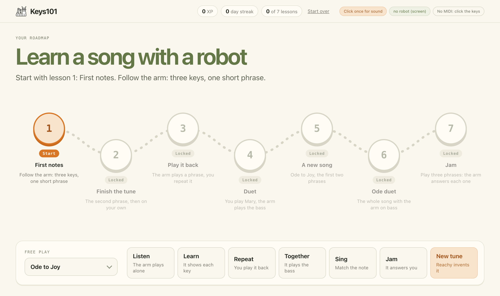
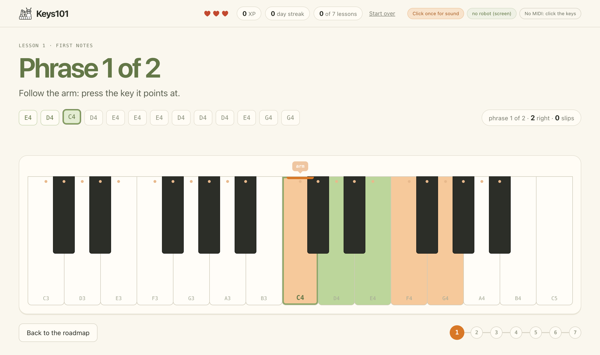
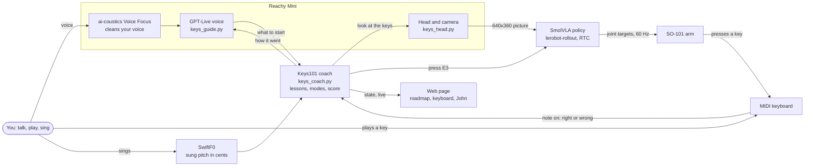

# Keys101

An SO-101 robot arm teaches you a song on a small MIDI keyboard, then plays it with you. A Reachy Mini is
the teacher you talk to: it works out what you want, and its head camera is the arm's only eye. Built at
HackLab #2 in Berlin (22 November 2026) on top of the SO-101 Piano Teacher below.

**Watch the three-minute demo:** [YouTube](https://youtu.be/V5HCgUEM5rY) ·
[the video file on Google Drive](https://drive.google.com/file/d/16pSH4EHyPetboCDCLgqJ06xjI9Kzsdf0/view?usp=sharing) ·
[the slides](https://drive.google.com/file/d/1Q-5JDIACw-7F8G2CWU52m7ZFYnHq4Hqp/view?usp=sharing)

[](https://youtu.be/V5HCgUEM5rY)





## What you can do

- **Lessons:** seven short ones in order, from three notes to a duet. Three hearts per lesson, XP for each
  one you finish.
- **Listen:** the arm plays a whole song by itself.
- **Learn:** the arm hovers over the next key and waits. Press a wrong key and it plays the right one, while
  John (a singing 3D head) sings its name.
- **Repeat:** the arm plays a phrase, you play it back. MIDI checks every note.
- **Together:** you play the tune, the arm is your bass player. You lead, it follows.
- **Sing:** Reachy says what comes, the arm plays a note and John sings it, then it is your turn. SwiftF0
  draws your pitch live and says how many cents off you were, and John shows how to fix it.
- **Jam:** play a short phrase and stop. The arm answers it.
- **New tune:** Reachy makes up four bars from the keys the arm knows, and the arm teaches them.

You can click, or just talk: "can you play something for me?", "I need a bass player", "you choose".
Reachy speaks through GPT-Live, hears you through ai-coustics Voice Focus, looks at whoever speaks, and
turns back to the keys before the arm plays.

## How it is built

- **The arm's brain:** SmolVLA with the vision encoder unfrozen, trained on a dataset the arm recorded by
  itself: it pressed sticker keys from poses taught once, and MIDI checked and labelled every press
  ("press E3"). The earlier experiments below were recorded by hand with the leader arm; this one had a
  single day, so the arm did the recording. See [RECORDING.md](RECORDING.md).
- **One press, one subtask:** a song is too long for one skill, so it is cut into subtasks. Every episode is
  one press with its own instruction, written by the script and confirmed by MIDI, never by hand. At run
  time the coach sends the next subtask note by note, and real-time chunking blends the policy's action
  chunks: 30 policy steps and 60 motor commands a second.
- **Camera only against camera and ears:** the same episodes trained two policies. One sees Reachy's
  camera; the other also gets the keyboard's sound drawn as a spectrogram, as a second camera.
- **Scored by MIDI:** every press is judged by the keyboard itself, so the numbers below needed no human.



The same loop made the training data: `keys_scripted.py` pressed the keys from taught poses, the MIDI
keyboard labelled and checked each episode, the dataset went to the Hub, and `lerobot-train` fine-tuned
SmolVLA on Hugging Face Jobs.

| Policy | Keys | Right key first |
| --- | --- | --- |
| Camera only | 12 white | 59 of 60 |
| Camera and ears | 12 white | 54 of 60 |
| Camera and ears, all keys | 12 white, 10 black | 17 of 22 |

The 22-key policy had 160 good black-key episodes against 595 white ones, and black keys are narrow.

Everything is on the Hugging Face Hub:

| What | Hugging Face |
| --- | --- |
| Policy, camera only, 12 white keys | [smolvla-keys101-camera-only](https://huggingface.co/PawelLach/smolvla-keys101-camera-only) |
| Policy, camera and ears, 12 white keys | [smolvla-keys101-camera-ears](https://huggingface.co/PawelLach/smolvla-keys101-camera-ears) |
| Policy, camera and ears, all 22 keys | [smolvla-keys101-22keys](https://huggingface.co/PawelLach/smolvla-keys101-22keys) |
| Data, 12 white keys, 595 episodes | [so101-keys101-12keys](https://huggingface.co/datasets/PawelLach/so101-keys101-12keys), [camera only](https://huggingface.co/datasets/PawelLach/so101-keys101-12keys-camera-only) |
| Data, all 22 keys, 755 episodes | [so101-keys101-22keys](https://huggingface.co/datasets/PawelLach/so101-keys101-22keys) |

Each policy repository holds the checkpoints of its training run under `checkpoints/<step>/pretrained_model`;
the scores above are from step 6,000.

**Sound helped before, and not today.** In the earlier experiment (leader arm, 134 episodes, 5,000 steps)
the policy with ears pressed a key exactly once in 7 of 13 runs, against 2 of 12 for camera only: it knew
when to stop. Today, with 595 scripted episodes, camera only was better at finding the right key. Those are
two different questions and small samples, so this is an open result, not a conclusion.

Other checks, all counted by MIDI: after Reachy's head looked away and came back, the camera policy pressed
24 of 24 keys right. With the keyboard moved about a centimetre it still got 46 of 60, while the fixed
taught poses missed 3 of 5 keys.

## Run it

```bash
R="uv run --with-requirements scripts/requirements-keys.txt"
$R scripts/keys_coach.py --arm sim                              # no robot: try it in the browser
$R scripts/keys_coach.py --arm scripted                         # the real arm, from taught poses
$R scripts/keys_coach.py --arm policy                           # SmolVLA presses the keys
$R --with aic-sdk==3.3.2 scripts/keys_coach.py --arm policy --voice   # and Reachy talks and looks around
$R --with aic-sdk==3.3.2 scripts/keys_coach.py --arm policy --voice --speaker "JBL Flip 7"   # its voice on another speaker
```

Then open http://localhost:8780. `--voice` needs `OPENAI_API_KEY` and an ai-coustics licence in `.env`.
Songs are plain text files in [`scripts/lessons`](scripts/lessons); your own go in `scripts/lessons/local/`.

| File | What it does |
| --- | --- |
| [`scripts/keys_coach.py`](scripts/keys_coach.py) | The app: lessons, modes, the scorer, the web server |
| [`scripts/keys_guide.py`](scripts/keys_guide.py) | Reachy's conversation: GPT-Live, Voice Focus, and what to start |
| [`scripts/keys_head.py`](scripts/keys_head.py) | Reachy's head: alive on the roadmap, back on the keys for the policy |
| [`scripts/keys_scripted.py`](scripts/keys_scripted.py) | Teaching poses and recording the dataset |
| [`web/coach.html`](web/coach.html) | The page |

# SO-101 Piano Teacher

A cheap robot arm (SO-101) that presses the keys of a MIDI keyboard, hears the notes it plays, and gives
basic singing lessons together with a Reachy Mini.

It started as one question: today's robot policies learn from camera images and joint positions, so what
changes if you also let one hear? Here the sound of the keyboard is drawn as a picture (a spectrogram) and
fed to a stock [SmolVLA](https://huggingface.co/docs/lerobot/smolvla) policy as a second camera. No model
change. The MIDI keyboard labels every recording and scores every press for free.

This is a hobby experiment, built at home on one rig. Expect rough edges.

## What is in here

| Path | What it does |
| --- | --- |
| `scripts/keys_teleop.sh`, `keys_flow_record.py` | Record demonstrations with the leader arm, one key per episode, labelled by MIDI |
| `scripts/keys_scripted.py` | The arm pressing keys from saved poses: recording, testing and the backup for demos |
| `scripts/keys_flow_train.sh`, `keys_variants.py` | Build the training sets and start SmolVLA training on Hugging Face Jobs |
| `scripts/keys_play.py` | Let a trained policy play a note or a tune, and score it from MIDI |
| `scripts/keys_companion.py` | The teacher: play notes you name, teach a tune, run a singing warm-up |
| `scripts/keys_listen.py` | SwiftF0 pitch tracking: is a sung note flat or sharp, and which notes are in a riff |
| `scripts/keys_voice.py` | The voice teacher: say "play mi sol la" or "start the lesson", the policy plays, you sing back |
| `scripts/keys_ui.py` | The stage display: serves `web/` live from the rig, the 3D arm follows the real one, your pitch live |
| `scripts/keys_reachy.py` | Reachy Mini holds its saved head pose while the arm plays, and moves and wiggles otherwise |
| `scripts/keys_rollout.py` | `lerobot-rollout` with a `/pause` command, so one loaded policy can play note after note |
| `scripts/keys_pitch_judge.py` | A test of whether Gemini Decision 1 can judge pitch (it cannot) |
| `scripts/keys_synth.py` | A small software piano for the MIDI keyboard, with a clean audio feed for the "ears" |
| `plugins/lerobot_camera_spectrogram` | LeRobot camera plugin: a microphone or audio cable as a spectrogram image |
| `plugins/lerobot_camera_scaled` | LeRobot camera plugin: capture at one size, deliver a smaller one |
| `scripts/test_keys.py` | Tests that need no hardware, microphone or API key |
| `web/` | A browser page: the arm and keyboard in 3D, a pitch meter and the singing lesson. Also the stage display. See `web/README.md` |

## Models and data

Everything the experiment used is public on Hugging Face. "Camera + ears" means the policy also gets the
sound picture; "camera only" is its deaf twin, trained on the same episodes.

| What | Hugging Face | Was called |
| --- | --- | --- |
| The policy shown live | [smolvla-so101-piano-flow](https://huggingface.co/PawelLach/smolvla-so101-piano-flow) | `train_2026-11-17_22-11-36` |
| Its data, 300 episodes | [so101-piano-flow-300ep](https://huggingface.co/datasets/PawelLach/so101-piano-flow-300ep) | `so101_keys_flow_300ep` |
| Policy, 268 episodes, camera + ears | [smolvla-so101-piano-268ep-camera-ears](https://huggingface.co/PawelLach/smolvla-so101-piano-268ep-camera-ears) | `train_2026-11-17_11-41-38` |
| Policy, 268 episodes, camera only | [smolvla-so101-piano-268ep-camera-only](https://huggingface.co/PawelLach/smolvla-so101-piano-268ep-camera-only) | `train_2026-11-17_11-41-46` |
| Data, 268 episodes | [camera + ears](https://huggingface.co/datasets/PawelLach/so101-piano-268ep-camera-ears), [camera only](https://huggingface.co/datasets/PawelLach/so101-piano-268ep-camera-only) | `so101_keys_teleop_20261116_212951_v2_both`, `..._v2_text` |
| Policy, 134 episodes, 5k steps | [camera + ears](https://huggingface.co/PawelLach/smolvla-so101-piano-134ep-camera-ears-5k), [camera only](https://huggingface.co/PawelLach/smolvla-so101-piano-134ep-camera-only-5k) | `smolvla_keys_both_5k`, `smolvla_keys_text_5k` |
| Training run, 134 episodes, camera only | [smolvla-so101-piano-134ep-camera-only-run](https://huggingface.co/PawelLach/smolvla-so101-piano-134ep-camera-only-run) | `train_2026-11-16_21-24-43` |
| Data, 134 episodes | [camera + ears](https://huggingface.co/datasets/PawelLach/so101-piano-134ep-camera-ears), [camera only](https://huggingface.co/datasets/PawelLach/so101-piano-134ep-camera-only) | `so101_keys_teleop_20261116_212951_both`, `..._text` |

The scripts still use the old names: Hugging Face redirects them, and the local copies on the rig are
filed under them.

## Hardware

- SO-101 follower and leader arms
- A USB MIDI keyboard with stickers 1 to 6 on six neighbouring white keys: C D E F G A (do re mi fa sol la)
- One camera that sees the keys and the arm (a Reachy Mini here)
- A Mac. The scripts use Apple Silicon for speech to text and the `mps` device

## Quick start

```bash
git clone https://github.com/LachPawel/so101-piano-teacher
cd so101-piano-teacher
uv run --with-requirements scripts/requirements-keys.txt pytest scripts/test_keys.py -q
```

Everything runs from the repository root with the same prefix:

```bash
uv run --with-requirements scripts/requirements-keys.txt scripts/keys_listen.py check mi
```

Each script starts with a docstring that explains what it does and how to run it.

## On stage

Three terminal tabs, then open http://localhost:8770 full screen:

```bash
uv run --with-requirements scripts/requirements-keys.txt scripts/keys_synth.py --ears "BlackHole 2ch"
```

```bash
uv run --with-requirements scripts/requirements-keys.txt scripts/keys_ui.py
```

```bash
uv run --with-requirements scripts/requirements-keys.txt --with aic-sdk==3.4.0 scripts/keys_voice.py --mic "MacBook Pro Microphone"
```

Once, with Reachy looking at the keys as in training: `scripts/keys_reachy.py save`. The display then
holds that head pose while the arm plays and moves Reachy otherwise.

The teacher speaks through Reachy Mini's own speaker when it is plugged in (`--speaker` to choose another).
Name the microphone: Bluetooth headphones that connect take over the Mac's default. The display
needs no internet; `scripts/keys_ui.py --demo` shows a made-up session without the rig.

## Things you will need to change for your own rig

- Serial ports and the robot id (`/dev/tty.usbmodem...`, `workshop_so101`) in the shell scripts and defaults
- Camera index and audio device names in `scripts/keys_cameras*.json`
- Hugging Face repository ids (`PawelLach/...`) for datasets and models
- `keys_poses.json` and `keys.json`: the saved arm poses and key sounds of my keyboard position

The trained policies only know my keyboard position, camera view and lighting. They will not work on another
rig without new recordings. The datasets and models are not public yet.

## Optional services

- [ai-coustics](https://ai-coustics.com) Quail Voice Focus cleans spoken commands. Needs `AIC_SDK_LICENSE`.
- `keys_voice.py` talks through OpenAI GPT-Live-1. Needs `OPENAI_API_KEY`.
- `keys_pitch_judge.py judge` uploads audio clips to Google. Needs `GEMINI_API_KEY`.

Keys are read from the environment first, then from the `.env` file named at the top of the script.
Never commit them.

## Built on

[LeRobot](https://github.com/huggingface/lerobot), pinned in `pyproject.toml` to the commit these scripts
were written against, and [SwiftF0](https://pypi.org/project/swift-f0/).
